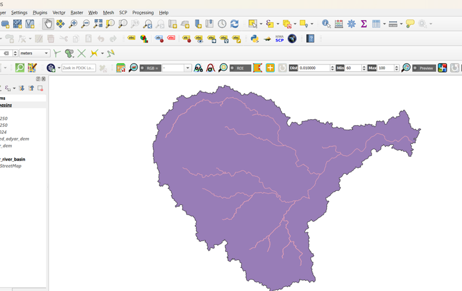
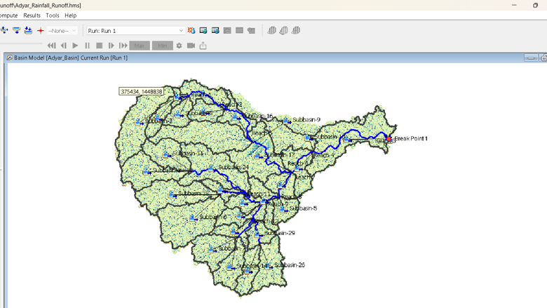
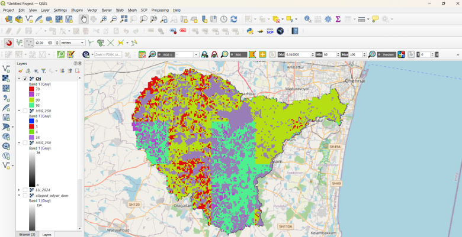
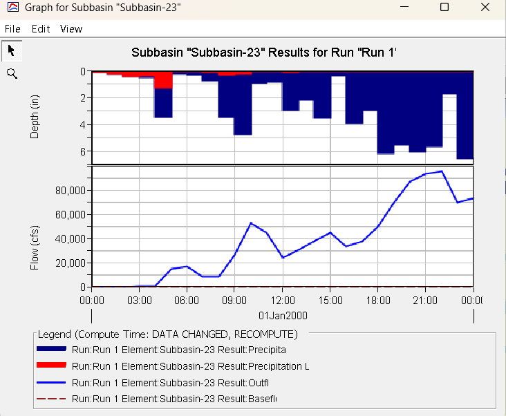

# Rainfall-Runoff Modelling of the Adyar River Basin (HEC-HMS)

**Tools:** HEC-HMS, QGIS, HiHydroSoil v2.0 (250m), Satellite LULC (2024), DEM  
**Focus:** Hydrological Modelling, Watershed Delineation, Urban Flood & Water Risk Assessment

---

## Project Overview
The **Adyar River Basin** in Chennai experiences rapid runoff response due to dense coastal urbanization and low-lying topography. This project explores event-based hydrological modelling in **HEC-HMS** to simulate watershed delineation, spatial curve number parameterization, and outlet runoff response.

---

## Methodology

### 1. Terrain Preprocessing & Watershed Delineation
* **Hydrologic Conditioning:** Processed the Digital Elevation Model (DEM) natively in HEC-HMS using *Preprocess Sinks* and *Preprocess Drainage* to establish continuous flow direction and accumulation.
* **Stream Network & Outlet Definition:** Defined stream thresholds and placed the basin outlet breakpoint at the Adyar Estuary to delineate **29 subbasins** and connecting river reaches.

### 2. Spatial Curve Number (CN) Grid Generation
* **Land Use & Soil Integration:** Combined the **2024 LULC** classification (Water, Built-up, Vegetation, Bare Land) with **250m Hydrologic Soil Group (HSG)** data using raster algebra in QGIS.
* **Parameterization:** Assigned standard SCS Curve Numbers (ranging from `70` for vegetated Soil C to `92–100` for impervious urban surfaces and water bodies) and extracted area-weighted CN values for each subbasin in HEC-HMS.

### 3. Hydrologic Loss, Transform & Routing Setup
* **Loss Method:** Applied the **SCS Curve Number** method to compute excess precipitation and infiltration losses.
* **Transform Method:** Used the **SCS Unit Hydrograph** method to transform excess rainfall into direct runoff hydrographs across all 29 subbasins.
* **Channel Routing:** Implemented **Lag routing** across river reaches to simulate flood wave translation downstream to the estuary outlet.

---

## Key Results & Simulation Report
* **Spatial Runoff Pattern:** Lower eastern subbasins within the Chennai metropolitan core exhibited the highest Curve Numbers (`90–92`) and fastest runoff response compared to upper rural catchments.

### Full HEC-HMS Simulation Report
[View Complete HEC-HMS HTML Output Report](../assets/maps/Report.html){ .md-button .md-button--primary }
